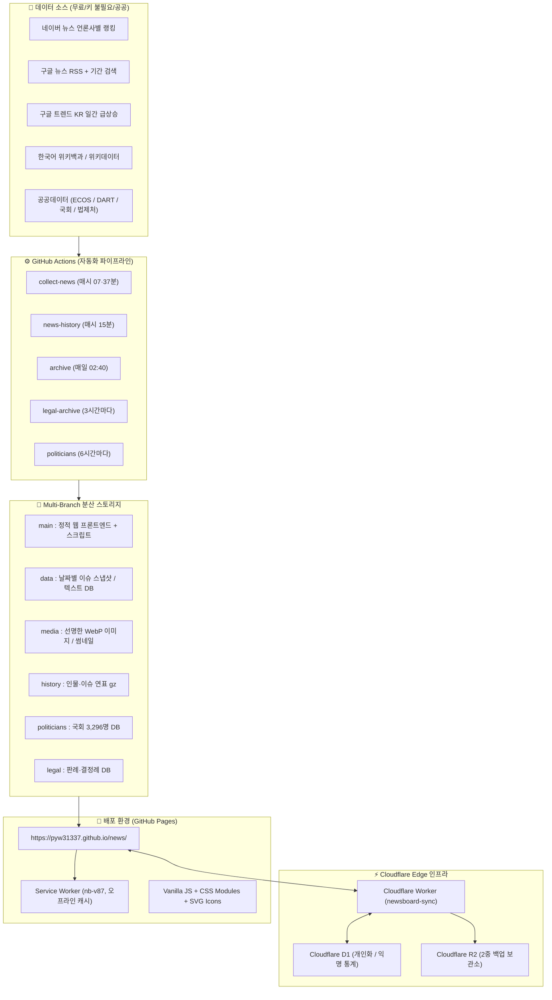

# NewsBoard (렛츠뉴스) — 프로젝트 명세서 (PROJECT.md)

> **서비스 배포 URL:** [https://pyw31337.github.io/news/](https://pyw31337.github.io/news/)  
> **저장소:** [github.com/pyw31337/news](https://github.com/pyw31337/news)  
> **최신 캐시 버전:** `nb-v87` (Service Worker)

---

## 1. 프로젝트 비전 & 핵심 가치

NewsBoard는 복잡하고 단편적인 포털 뉴스를 탈피하여 **"오늘 가장 중요한 이슈 TOP 10과 그 사건이 흘러온 타임라인(맥락), 그리고 인물 아카이브"**를 누구나 직관적으로 파악할 수 있도록 돕는 인터랙티브 뉴스 보드입니다.

- **심장: 이슈 타임라인(흐름)** — 단순 목록이 아니라 사건의 과거 발단부터 현재까지의 시계열적 연결.
- **기둥: 인물 아카이브(Blackbox)** — 정치인·연예인·인플루언서의 평생 행적, 발언, 관계망 추적.
- **맥락 보강:** 여론(민심 온도/키워드), 거시 시장 지표(환율/금리/주식/유가), 4컷 만화 및 퀴즈.
- **인터랙션:** 단순 읽기가 아닌 '만지고 넘기는 뉴스' (터치/제스처 모듈, 퀴즈, 게이미피케이션).

---

## 2. 전체 시스템 아키텍처



---

## 3. 디자이너 & 개발자 협업 헌장 (Core Design & Dev Principles)

본 프로젝트는 디자이너의 심미성과 사용자 경험을 최우선으로 합니다.

| 영역 | 핵심 원칙 | 가이드라인 |
|---|---|---|
| **비용 정책** | **100% 무료 티어** | 서버리스(GitHub Pages, Actions, Cloudflare Free) 내에서 모든 파이프라인을 운영합니다. |
| **타이포그래피** | **Pretendard 단일 폰트** | 크기와 자간, 굵기(Weight) 대비로 계층을 표현하며, 세리프(바탕체)는 발언/인용문에만 제한 사용합니다. |
| **아이콘 시스템** | **Tabler 아이콘 표준** | 라인 아이콘(꺼짐) / 솔리드 채움(켜짐) 상태를 통일하고, 이모지 남용을 지양합니다 (`assets/icons.js`). |
| **이미지 해상도** | **해상도 = 신뢰도** | 최소 2x DPR 이상의 선명한 원본만 채택하며, `WebP(q82)` 포맷으로 압축 보관합니다 (`assets/sharp.js`). |
| **UI 컴포넌트** | **시스템 순수 UI 금지** | 브라우저 기본 컨트롤 대신 자체 디자인 시스템 컴포넌트(`assets/ds.js`, `assets/ds.css`)를 사용합니다. |
| **공개 화면 청결성** | **기술/디버그 문구 배제** | 진단 로그, 에러 스택 등 시스템 문구는 사용자 화면에 노출하지 않고 `/admin` 대시보드로 격리합니다. |

---

## 4. 프로젝트 구조 및 주요 파일

```
.
├── index.html                  # v1 메인 애플리케이션 진입점
├── sw.js                       # Service Worker (PWA 캐시 관리: nb-v87)
├── package.json                # 프로젝트 메타데이터 및 실행 스크립트
├── pyproject.toml              # 파이썬 의존성 및 린트 설정 (PEP 621)
├── requirements.txt            # GitHub Actions용 필수 pip 패키지
├── assets/                     # 정적 리소스 (JS, CSS, 뱃지, 플랫폼 아이콘)
│   ├── app.js                  # 메인 앱 라우터 및 상태 관리
│   ├── ds.js / ds.css          # 디자인 시스템 컴포넌트
│   ├── touch.js / touch.css    # '만지는 뉴스' 모바일 제스처 인터랙션 모듈
│   ├── econ.js / mkt.js        # 금융·거시경제 차트 및 지표판
│   ├── my.js / my.css          # 마이페이지 및 로컬/D1 데이터 동기화
│   └── sharp.js                # 이미지 해상도 필터링 및 렌더러
├── scripts/                    # 자동화 수집·분석·가공 파이프라인
│   ├── collect.py              # 네이버·구글 뉴스 랭킹 수집 및 이슈 클러스터링
│   ├── enrich.py               # 타임라인 흐름, 여론, AI 요약 보강
│   ├── validate_project.py     # 사이트 무결성 및 스모크 테스트 스크립트
│   └── build_pages.py          # 이슈/엔티티 정적 SEO 페이지 빌더
├── worker/                     # Cloudflare Worker 소스 (인증/동기화/백업)
├── v2/                         # 차세대 리뉴얼 시안 및 실험실 (Lab)
├── docs/                       # 상세 가이드 (디자인 시스템, API 키, 로드맵)
├── HANDOFF.md                  # 작업 인수인계 및 히스토리 상세 문서
└── PROJECT.md                  # [본 문서] 프로젝트 명세서
```

---

## 5. 실행 및 개발 명령어

```bash
# 1. 프로젝트 정합성 및 무결성 검증 (Smoke Test)
npm run validate
# 또는 python3 scripts/validate_project.py

# 2. 로컬 웹 개발 서버 실행
npm run dev
# 브라우저에서 http://localhost:3000 접속

# 3. Cloudflare Worker 로컬 테스트 & 배포
npm run worker:dev
npm run worker:deploy
```

---

## 6. 프로덕션 승격 로드맵 (Production Elevation Roadmap)

1. **빌드 자동화 & 캐시 버스팅 고도화 (완료 ✅)**
   - 수동으로 관리하던 `sw.js`의 `nb-vNN` 및 `?v=NN` 쿼리를 GitHub Actions 배포 단계에서 git commit hash 기반 자동 주입 체계(`scripts/inject_cache_version.py`)로 완전 자동화 구축.
2. **ESM 모듈화 및 번들러 점진적 도입**
   - 현재 전역 `window` 객체에 의존하는 거대 JS 파일들을 Vite 기반 표준 ES 모듈 번들 구조로 리팩토링 검토 (성능 최적화 및 코드 분할).
3. **v2 리뉴얼 단계적 통합**
   - 사용자 검증을 마친 `v2/lab.js`의 만지는 뉴스 모듈들을 메인으로 정식 승격 완료 후 v2 루트 마이그레이션.
4. **자체 도메인 연동 & 브랜드 승격**
   - `pyw31337.github.io/news/`에서 정식 커스텀 도메인(예: `newsboard.kr` 등) 연동 준비.
