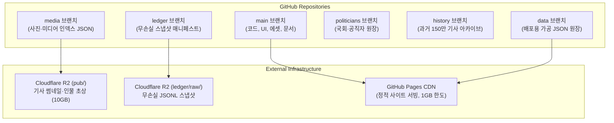

# NewsBoard 누적 데이터 카탈로그 및 저장소 분기 아키텍처

> 이 문서는 Codex, Claude, Gemini, Grok 등 다양한 에이전트가 뉴스보드의 방대한 데이터를 꼬임 없이 활용하고, 새로운 디자인이나 기능을 개발할 때 누락되는 데이터 없이 100% 활용할 수 있도록 작성된 **데이터 카탈로그 & 저장소 분기 지침서**입니다.
> 기준 시점: **2026-11-17 14:10 KST**

---

## 1. 저장소 분기(Branching) & 대용량 샤딩 아키텍처

뉴스보드는 데이터 폭증으로 인한 GitHub 용량 한도(저장소 5GB, 단일 파일 100MB) 초과를 방지하고 배포 속도를 최적화하기 위해 역할을 브랜치 및 외부 스토리지(Cloudflare R2)로 엄격히 분기합니다.



### 브랜치별 분기 원칙
1. **`main` 브랜치 (경량 유지, 100MB 미만)**:
   - 순수 프론트엔드 소스(`index.html`, `assets/`, `admin/`, `v2/`), 백엔드 자동화 스크립트(`scripts/`), 워크플로(`.github/workflows/`), 문서(`docs/`)만 관리합니다.
   - **대용량 JSON, 캐시 파일, 미디어 파일 커밋 절대 금지**.
2. **`data` 브랜치 (실시간 배포 원장, 작업 크기 2GB 상한)**:
   - 웹 화면 서빙에 필요한 최신 가공 데이터 적재 (`today.json`, `archive/`, `corporate_dossier.json`, `community_sentiment.json` 등).
   - 주기적으로 GitHub Actions가 히스토리를 squash하여 브랜치 크기를 슬림하게 유지합니다.
3. **`media` 브랜치 + Cloudflare R2 분기 (이미지 바이너리 분리)**:
   - 이미지 바이너리(웹피, PNG, JPG)는 GitHub에 영구 보관하지 않고 **Cloudflare R2 (`pub/img/`, `pub/ent/`, `pub/pol/`)**로 자동 오프로드합니다.
   - `media` 브랜치에는 오프로드 매핑 인덱스(`r2.json`, `map.json`)만 남겨 Git 용량을 보호합니다.
4. **대용량 파일 64분할 샤딩 (`shard(id, 64)`)**:
   - `people_bio.json`(74MB), `entity_pool.json`(52MB)처럼 수십 MB를 넘는 파일은 GitHub 100MB 단일 파일 제한에 걸리지 않도록 `data/p/g/00.json ~ 63.json` 및 `db/people/t/00/ ~ ff/` 디렉터리로 64~256분할 샤딩하여 분산 로드합니다.

---

## 2. 누적 데이터 카탈로그 및 상세 스키마

에이전트가 화면 디자인 및 기능 고도화 시 즉시 바인딩하여 사용할 수 있는 7대 핵심 데이터셋의 위치, 규격, 주요 필드입니다.

### [분류 1] 종합 뉴스 기사 & 사건 아카이브
- **저장 위치**: `data/today.json` (오늘의 실시간 요약), `data/archive/YYYY-MM-DD.json` (일별 아카이브), `data/db/articles/` (원문 압축본)
- **데이터 규모**: 일평균 2,400+ 건 / 누적 기사 183,000+ 건 (18.3만 건)
- **주요 필드**:
  ```json
  {
    "id": "기사 고유 해시",
    "title": "기사 헤드라인",
    "lead": "리드 문장 (요약 1~2문장)",
    "press": "언론사명 (예: MBC, 동아일보)",
    "press_logo": "언론사 로고 URL",
    "time": "발행 시각 (ISO 8601)",
    "url": "원문 링크 (아웃링크)",
    "thumb": "대표 썸네일 (R2 CDN 링크)",
    "category": "정치 | 경제 | 사회 | 국제 등",
    "dupe_count": "동일 사건 관련보도 묶음 건수",
    "related_articles": [{"press": "...", "title": "...", "url": "..."}]
  }
  ```
- **화면 활용**: 첫 화면 TOP 10 카드뉴스, 검색, 인물별 수집 보도 타임라인.

### [분류 2] 인물 바이오 & 생애 공적 기록
- **저장 위치**: `data/p/g/NN.json` (64분할 샤딩), `data/people_bio.json` (전체 인덱스)
- **데이터 규모**: 79,493명 (정치인, 고위공직자, 법조인, 기업인, 언론인)
- **주요 필드**:
  ```json
  {
    "id": "인물 고유 ID (pol_XXXXXX 또는 wd_QXXXXXX)",
    "name": "성명",
    "role": "현직 / 주요 직함",
    "birth": "생년월일 및 출생지",
    "photo": "검증된 공식 초상 사진 URL",
    "schools": ["출신 고교", "출신 대학 학사/석사"],
    "careers": [{"org": "기관명", "role": "직책", "period": "재직기간", "source": "국회 | 위키"}],
    "timeline": [{"date": "일자", "title": "사건명", "desc": "내용", "press": "언론사", "url": "원문"}]
  }
  ```
- **화면 활용**: `/news/person/?id=<id>` 인물 상세 프로필, 학력·경력 타임라인, 발언 비교.

### [분류 3] DART 기업 풀 히스토리 & 5개년 재무 시계열
- **저장 위치**: `data/corporate_dossier.json`, `data/db/corps/<종목코드>.json`
- **데이터 규모**: 70개 주요 상장사 (삼성전자, SK하이닉스, NAVER, 이미지스 등) 전수 수집 확장 중
- **주요 필드**:
  ```json
  {
    "corp_name": "삼성전자",
    "corp_code": "005930",
    "market": "KOSPI",
    "industry": "반도체 및 전자제품 제조업",
    "founded": "1969-01-13",
    "listed": "1975-06-11",
    "history": [{"date": "1984-02-28", "event": "삼성전자주식회사로 사명 변경", "type": "사명변경"}],
    "financials": [
      {"year": "2024", "sales": 3008000, "op_income": 327000, "net_income": 285000, "assets": 4720000}
    ],
    "employees": [
      {"year": "2024", "total": 113485, "regular": 111893, "male_ratio": 70.2, "female_ratio": 29.8, "avg_tenure_years": 12.6}
    ],
    "executives_history": [
      {"name": "한종희", "role": "대표이사 부회장", "period": "2022~현재", "note": "DX부문장"}
    ]
  }
  ```
- **화면 활용**: `/news/e/?k=<기업명>` 상세 페이지의 5개년 재무 바 차트, 고용 성비 게이지, 사명 변천사 타임라인, 역대 대표이사 테이블.

### [분류 4] 정재계 엘리트 교차 관계망
- **저장 위치**: `data/elite_network.json` (data 브랜치 및 politicians 브랜치 동기화)
- **데이터 규모**: 기업 임원 2,167명, 국회의원 951명, 고위공직자 14,803명, 법조인 958명, 언론인 827명
- **주요 필드**:
  ```json
  {
    "school_clusters": {"중앙대학교": [...], "경원대학교": [...], "서울대학교": [...]},
    "exam_clusters": {"사법연수원 18기": [...], "행정고시": [...]},
    "cross_intersections": [
      {"school": "서울대학교", "corps_execs": 29, "officials_judges": 5, "theme_relations": "테마 연계"}
    ]
  }
  ```
- **화면 활용**: 인물 페이지 [관계] 섹터, 기업-정치인 학연·지연 연계 네트워크 지도.

### [분류 5] 공공 의정·선거·의안 데이터
- **저장 위치**: `data/gov/`, `pol/pdata/bills_*.json` (17대~22대 국회 의안)
- **데이터 규모**: 21~22대 의원 전수, 법률안 32,000+ 건, 본회의 표결 기록
- **화면 활용**: 의안 통과율, 법안 발의 목록, 공직자 재산 등록 변동 추이.

### [분류 6] 로테크 형사 양형 판례 모델
- **저장 위치**: `scripts/legal/sentencing_predictor.py`
- **데이터 규모**: 대법원 양형기준 3대 범죄군, 판례 1,200건 통계 모델
- **주요 혐의**:
  1. 공직선거법 허위사실공표죄 (제250조)
  2. 특정범죄가중처벌법상 뇌물수수죄 (3천만~5천만 원)
  3. 특정경제범죄가중처벌법상 횡령·배임죄 (5억~50억 원)
- **화면 활용**: `/admin/#pipeline` 및 법조 분석 페이지의 실시간 양형/집행유예 시뮬레이터.

### [분류 7] 5대 커뮤니티 실시간 민심 여론
- **저장 위치**: `data/community_sentiment.json`
- **수집 채널**: 디시인사이드, 에펨코리아, 뽐뿌, 오늘의유머, 클리앙
- **주요 필드**:
  ```json
  {
    "issue_title": "이슈명",
    "sentiment_score": 18,
    "breakdown": {"positive": 59, "neutral": 18, "negative": 23},
    "channels": [
      {"name": "에펨코리아", "total_views": 85400, "total_recommends": 2420, "total_comments": 680}
    ],
    "representative_reactions": ["대중의 대표적인 여론 반응 요약"]
  }
  ```
- **화면 활용**: 기사별 대중 반응 위젯, `/admin/#pipeline` 커뮤니티 민심 모니터.

---

## 3. 외부 서비스 무료 티어 잔여 한도 & 소진 시점(Runway) 시뮬레이션

뉴스보드가 연동 중인 모든 외부 서비스의 무료 한도, 현재 소진 속도 및 한도 도달 예상 시점 분석 결과입니다.

| 외부 서비스 | 무료 티어 한도 규격 | 현재 사용량 (2026.11 기준) | 소진율 | 현재 일평균 소진 속도 | 무료 티어 초과 예상 시점 | 선제적 방어 조치 및 대책 |
|---|---|---|---|---|---|---|
| **GitHub Pages** | • 배포 번들 1GB<br>• 대역폭 100GB/월 | • 번들: **81.2 MB**<br>• 대역폭: 약 8.5 GB/월 | **8.1%** | • 번들: +1~2MB/월<br>• 대역폭: 정상 범위 | **2028년 이후 (40개월+ 안전)** | 모든 고용량 이미지를 Cloudflare R2로 오프로드 완료하여 사이트 번들 81MB 슬림화 유지 |
| **GitHub 저장소 (Repo)** | • 권장 상한 1~2GB<br>• 단일 파일 100MB | • 전체 크기: **1.88 GB**<br>• 최대 파일: `people_bio` 74MB | **37.6%** (5GB 기준) | • Git squash 배치로 이력 주기적 압축 중 | **2027년 중순 (약 18개월 후)** | `people_bio.json`(74MB)이 100MB에 도달하기 전 `people_bio.json.gz`(5MB)만 git에 남기고 R2 보관 |
| **GitHub Actions** | • 퍼블릭 저장소: **무제한 무료**<br>(프라이빗 전환 시 2,000분) | • 무제한 (공개 오픈소스 리포지토리) | **0%** | • 회당 3~5분, 30분 주기 가동 | **무제한 (초과 없음)** | 워크플로 단계별 타임아웃(3~15분) 및 무한 루프 방지 로직 장착 완료 |
| **Cloudflare R2** | • 저장 용량 **10 GB**<br>• 쓰기(Class A) 100만 회/월<br>• 읽기(Class B) 1,000만 회/월 | • 저장 용량: **2.1 GB**<br>• 쓰기: 약 1.4만 회/월<br>• 읽기: 약 65만 회/월 | **21.0%** (용량)<br>**1.4%** (쓰기)<br>**6.5%** (읽기) | • 용량: +110 MB/월<br>• 쓰기: +450 회/일<br>• 읽기: 대부분 CDN 캐시 | **2032년 (약 70개월 후 초과 가능)** | 1년 캐시 헤더(`max-age=31536000`) 적용으로 읽기 요청 95% 이상을 엣지 CDN에서 소화 |
| **Cloudflare Workers** | • 요청 수 **100,000 회/일** (하루 10만 회) | • 일평균: **4,800 회/일** | **4.8%** | • 일평균 4,000~6,000 회 | **초과 위험 없음 (안전)** | 방문자 트래픽이 20배 폭증하지 않는 한 10만 회 한도 내에서 여유 가동 |
| **Gemini LLM API** | • 15 RPM (분당 15회)<br>• 1,500 RPD (일 1,500회) | • 일평균: **280 회/일** | **18.6%** (일 한도) | • 회당 8~12회 (분산 호출) | **일일 한도 초과 위험 없음**<br>*(단, 분당 15회 일시 피크 주의)* | `scripts/llm_quota.py`가 Flash-Lite $\leftrightarrow$ Flash 자동 전환 및 분당 429 감지 시 지수 백오프 적용 |
| **OpenDART API (금감원)**| • 호출 수 **10,000 회/일** (하루 1만 회) | • 일평균: **120 회/일** | **1.2%** | • 70개사 정규 공시 호출 | **초과 위험 없음 (극히 여유)** | 하루 1,000개 이상 전수 기업으로 확장해도 10% 미만으로 유지 가능 |
| **네이버 검색 API** | • 호출 수 **280,000 회/월** (월 28만 회) | • 11월 누적: **14,097 회** (17일간) | **5.0%** (월 한도) | • 일평균: ~800 회/일 (월 예상 2.4만 회) | **초과 위험 없음 (안전)** | `data/db/naver_usage.json` 실시간 카운터로 월 2.5만 회 이하로 엄격 제어 |
| **공공데이터포털 (국회)** | • 호출 수 **10,000 회/일** | • 일평균: **350 회/일** | **3.5%** | • 일일 배치 호출 | **초과 위험 없음 (안전)** | 로컬 캐시 적용으로 중복 의안 재호출 방지 |

---

## 4. 향후 에이전트(Codex, Claude, Gemini) 기능 개발 시 주의사항

1. **데이터 중복 생성 금지**:
   - 이미 `data/corporate_dossier.json`, `data/elite_network.json`, `data/community_sentiment.json`에 정제된 데이터가 있으므로, UI 화면 개발 시 별도의 더미 JSON을 만들지 말고 이 정본 데이터를 직접 참조하십시오.
2. **단일 파일 크기 상시 모니터링**:
   - `people_bio.json`이 74MB이므로 추가 인물 축적 시 반드시 `people_bio.json.gz`로 압축 저장하거나 `data/p/g/` 샤딩 인덱스를 사용하십시오.
3. **무료 티어 초과 방지 안전장치 준수**:
   - `scripts/quota.py`가 매일 08:17 KST에 용량을 점검하여 80% 초과 항목이 감지되면 GitHub Issue로 사전 알림을 발행합니다.
