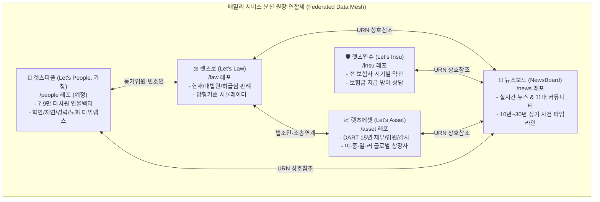

# 패밀리 서비스 간 분산 원장 & 다차원 온톨로지 데이터 메시 아키텍처

> **설계 원칙**: 컬처플로우(CultureFlow)가 전국 문화·공연 데이터를 전담 수집·관리하고 렛츠캠핑(Let's Camping)이 캠핑장 주변 정보로 소비하듯, 
> 각 도메인은 독립 레포지토리에서 **단일 진실 공급원(Single Source of Truth, SSOT)**으로 원장을 수집·분석·관리하며, 
> 패밀리 서비스 간에는 **글로벌 온톨로지 식별자(URN)**를 매개로 정보를 유기적으로 교류한다.

---

## 1. 5대 독립 서비스 역할 분담 및 레포지토리 구성

| 서비스명 | 독립 레포 경로 | 전담 도메인 | 핵심 기능 및 비전 |
|---|---|---|---|
| **렛츠로 (Let's Law)** | `/Users/pyw31337/Developer/law` | 법률·판례·양형 | 헌법/대법원/하급심 25대 리딩 판례, 양형기준 시뮬레이터, 판례 기반 형량 예측 |
| **렛츠인슈 (Let's Insu)** | `/Users/pyw31337/Developer/insu` | 보험 약관·지급상담 | 전 생보/손보사 1~4세대 실손 변천 약관, 원발암 vs 전이암, 소비자 부지급 방어 가이드 |
| **렛츠에셋 (Let's Asset)** | `/Users/pyw31337/Developer/asset` | 기업·증권·자산 | DART 재무(15년)+임원+감사의견+제재, 미국 SEC 6,850사, 미·중·일·러 강대국 자산 |
| **렛츠피플 (가칭)** | `/Users/pyw31337/Developer/people` (준비) | 인물백과·관계망 | 정재계·법조·언론 79,493명, 학연/지연/경력망, WebP 85% 압축 및 노화 타임랩스 |
| **뉴스보드 (NewsBoard)** | `/Users/pyw31337/Developer/newsboard-local/news` | 뉴스·여론·사건 | 실시간 뉴스(일 2.5만건), 11대 커뮤니티 8대 카테고리 여론, 10~30년 장기 사건 분석 |

---

## 2. 글로벌 온톨로지 식별자 (Global Federated URN) 표준

모든 서비스는 데이터를 주고받을 때 표준 URN을 키(Key)로 사용합니다:

1. **법률 (Law)**:
   - 판례: `urn:law:precedent:{법원}:{사건번호}` (예: `urn:law:precedent:scourt:2019도11626`, `urn:law:precedent:ccourt:2016헌나1`)
   - 법조문: `urn:law:statute:{법률명}:{조문}` (예: `urn:law:statute:특경법:제3조`)
2. **보험 (Insurance)**:
   - 약관: `urn:insu:policy:{보험사}:{상품코드}:{개정시기}` (예: `urn:insu:policy:samsung_fire:actual_loss:gen1_2000`)
   - 분쟁조정례: `urn:insu:dispute:{조정번호}` (예: `urn:insu:dispute:fss-2023-14`)
3. **기업 및 자산 (Asset & Securities)**:
   - 국내 상장사: `urn:asset:corp:kr:{종목코드}` (예: `urn:asset:corp:kr:005930`)
   - 미국 상장사: `urn:asset:corp:us:{티커}` (예: `urn:asset:corp:us:NVDA`, `urn:asset:corp:us:AAPL`)
   - 글로벌 다국적사: `urn:asset:corp:{국가코드}:{종목코드}` (`cn:002594`, `jp:7203`, `ru:GAZP`)
4. **인물 (People)**:
   - 인물 고유 식별자: `urn:people:person:{p_id}` (예: `urn:people:person:p-lee-jaeyong`, `urn:people:person:p-jensen-huang`)
5. **뉴스 및 사건 (News & Events)**:
   - 사건 이슈: `urn:news:issue:{issue_id}` (예: `urn:news:issue:case-park-soohong`)

---

## 3. 서비스 간 데이터 교류 프로토콜 (Federation Exchange Protocol)

- **생산자(Producer)**: 각 서비스는 자신의 레포지토리에서 데이터를 수집·가공하여 `data/*.json` 형태로 배포.
- **소비자(Consumer)**: 뉴스보드 등 외부 서비스는 `FederatedDataMeshClient` (Python) 및 `FederationBridge` (JS)를 통해 원격 엔드포인트 또는 로컬 폴백을 통해 실시간 결합.
- **장점**:
  1. 각 서비스의 저장소와 코드가 격리되어 빌드/배포 속도 극대화.
  2. 한 서비스의 장애나 스키마 변경이 타 서비스로 전이되지 않음.
  3. 온톨로지 링크를 통해 필요할 때만 상세 정보를 가져오므로 로컬 스토리지 부하 전무.
